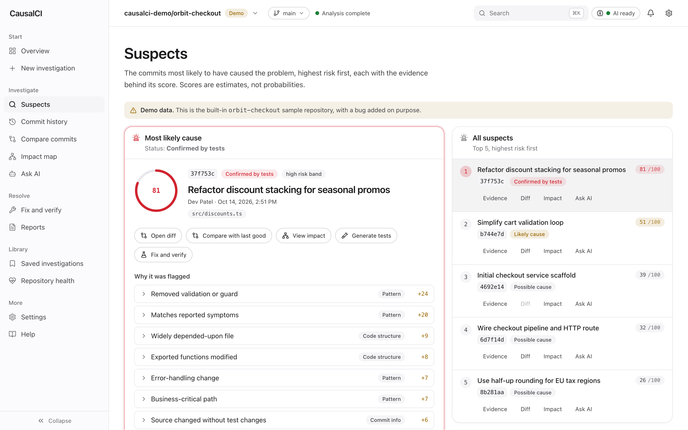
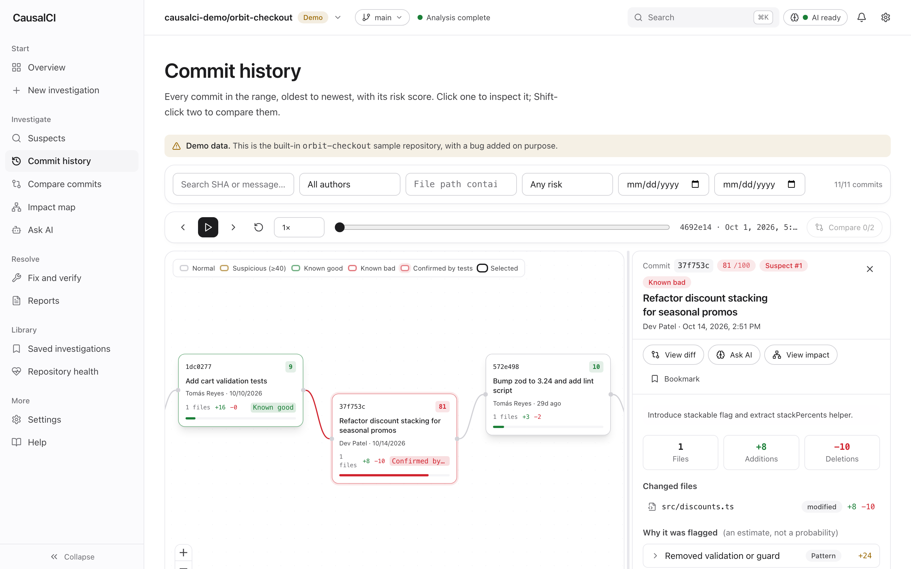
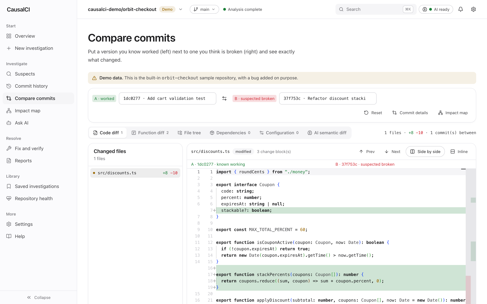
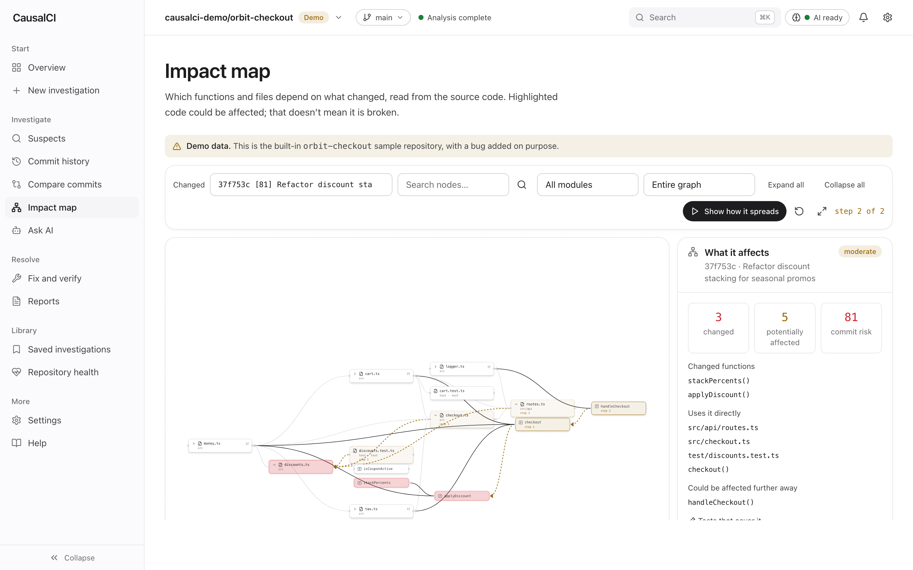
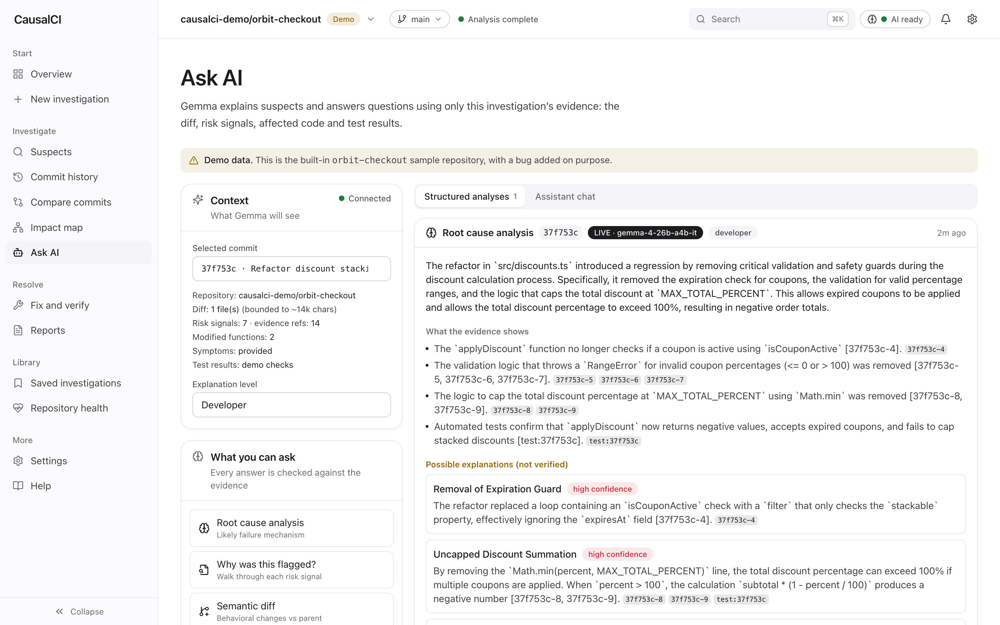
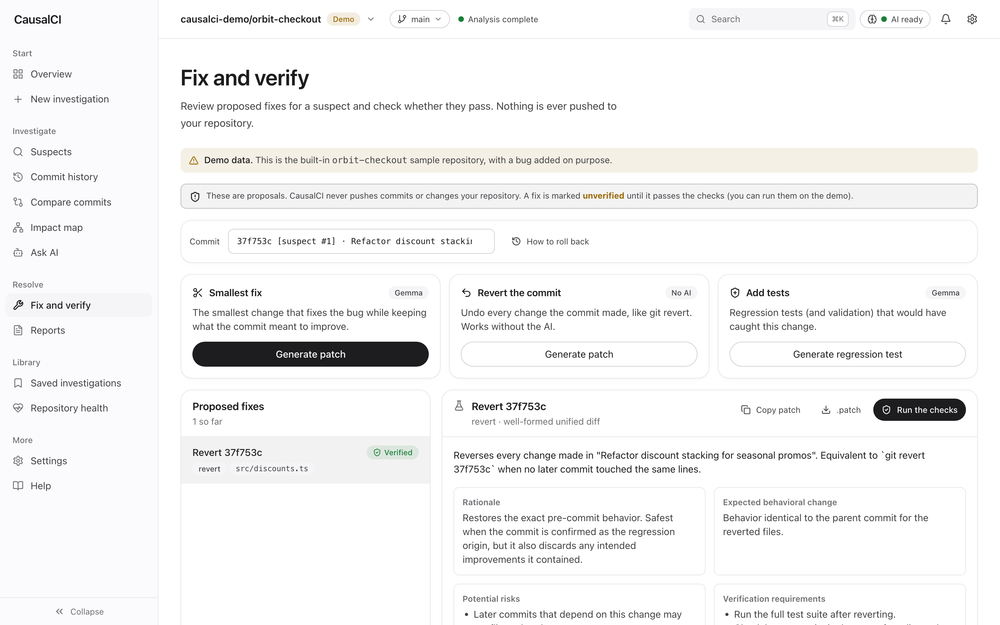
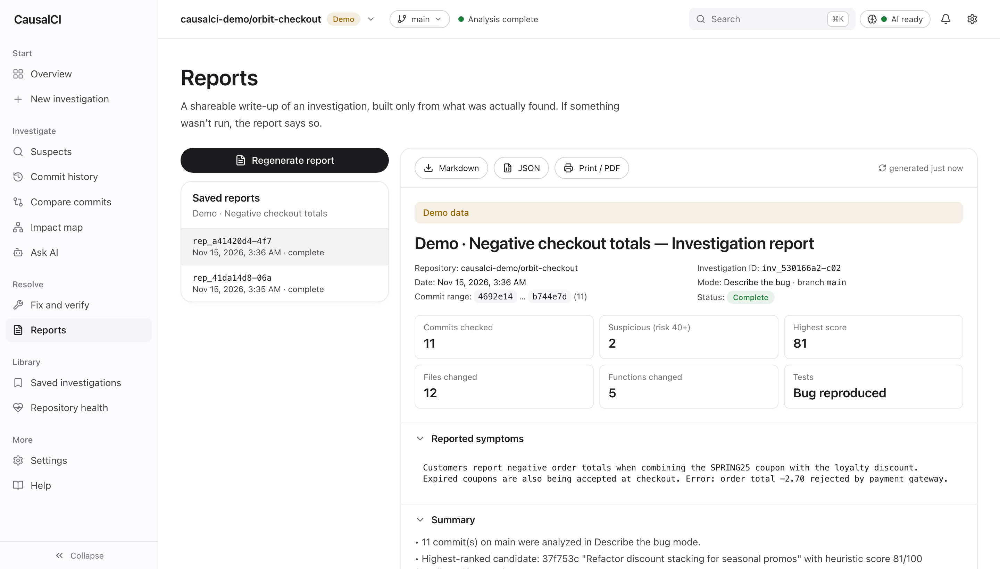

# CausalCI

**When CI goes red, CausalCI proves which commit caused it.** It ranks the suspects with a model trained on real regressions, re-runs the repository's own tests in isolated sandboxes with a flaky-aware search, and reports the culprit with its confidence and the evidence.

[](https://github.com/SwethaatGH/CausalCI/actions/workflows/ci.yml)

Import a GitHub repository and CausalCI:

- ranks the commits most likely to have caused the problem, with **a reason and a source for every score**;
- shows exactly what changed, and which code depends on it, from a **call graph built from the TypeScript compiler**;
- has **Gemma 4** explain the evidence, with every answer checked against it;
- proposes fixes, checks them, and writes a shareable report.


## Beyond the dashboard: finding the culprit for real

The UI explains suspects. The engine underneath **runs the repository's own tests in sandboxes and proves which commit broke the build**, and it was measured on real regressions, not a demo.

| | Result |
|---|---|
| **Learned suspect ranker** (76 real regressions mined with SZZ + reverts from ky, axios and express; leave-one-repo-out) | culprit in the top 3 **64.5%** of the time vs. 44.7% for the best baseline and 15% for random ([details](docs/EVALUATION.md#1-ranking-on-real-regressions)) |
| **Flaky-aware Bayesian bisection** (simulated suite with 5% false failures, 10% misses) | right **97.9%** of the time vs. 61.0% for `git bisect` ([details](docs/EVALUATION.md#2-search-under-flaky-tests-simulated)) |
| **Parallel k-way bisection** | wall-clock rounds 6 → 3 at 64 commits, 9 → 4 at 512 |

How it works:

1. **Range.** A red CI run on `main` (GitHub Action), a metric shift lined up with a deploy (change-point detection, `causalci signal`), or a range you give it.
2. **Rank.** A logistic-regression ranker trained on mined regressions orders the commits; the transparent risk signals explain each one.
3. **Search.** Bayesian bisection seeded with the ranking tests where the expected information gain is highest and stops at 95% confidence; k-way mode runs probes in parallel. Regression test selection over the AST call graph can narrow what each run executes.
4. **Sandbox.** Each run happens in a fresh read-only worktree with no network, no capabilities, a non-root user, resource limits and optional gVisor. Dependencies are installed once per lockfile hash. In production every run is a hardened Kubernetes Job on a gVisor node pool ([threat model](docs/THREAT_MODEL.md)).
5. **Report.** Culprit, confidence, every run's result, a comment on the culprit commit, and an optional draft revert PR.

It runs as a CLI (`causalci`), a queue-driven service (API → Redis → KEDA-autoscaled workers, Prometheus and Grafana), and an **MCP server**, so coding agents can check their own changes. Design decisions are recorded in [docs/adr](docs/adr).


---

## Features

| Page | What it does |
|---|---|
| **Overview** | Where an investigation stands: the most likely cause, commits and functions checked, risk levels, top suspects, most-changed files and progress. |
| **New investigation** | Pick a repository by URL or `owner/name`, a branch and the commits to check. Five ways to search: **Recent commits**, **Between good and bad** (a known-good and a known-bad commit), **One commit**, **Browse history**, and **Describe the bug** (your symptoms decide which commits come first). Progress streams live. |
| **Suspects** | The ranked suspects. For each one: why it was flagged (labeled *code structure*, *pattern* or *commit info*), the evidence, an AI explanation, and how to confirm it. Statuses are honest: *confirmed by tests*, *likely cause*, *possible cause*, *not enough evidence*. |
| **Commit history** | Every commit in the range as a zoomable chain, with filters, search, playback, Shift-click to compare two commits, bookmarks and a per-file change trail. |
| **Compare commits** | Side-by-side or inline diff of a version that worked and one that's broken, with tabs for code, functions, file tree, dependencies, configuration and an AI summary of the behavior change. |
| **Impact map** | Which functions and files call or import the changed code, step by step, with what it affects, the tests that cover it, and the source. |
| **Ask AI** | Seven structured analyses (root cause, why it was flagged, behavior change, impact, tests, fixes, other explanations) at beginner, developer or expert level, plus a chat. Answers cite evidence; anything the model invents is removed and flagged. |
| **Fix and verify** | Three kinds of fix: the smallest fix (AI), reverting the commit (no AI), or adding tests. Preview, copy or download the patch, roll-back steps, and a check that re-runs the demo's tests on the fixed code. |
| **Reports** | Saved reports with the evidence, exported as Markdown, JSON or PDF. If something wasn't run, the report says so. |
| **Repository health** | Activity, contributors, files that change most, risk over time and hotspots. Not test coverage. |
| **Saved investigations** | Search, rename, reopen, duplicate and delete past work, with notes and bookmarks. |
| **Everywhere** | ⌘K search across commits, files, functions and findings; shareable links to any view; keyboard shortcuts; light and dark mode following your Mac; reduced-motion support; works on small screens. |

### Honesty rules built into the product

- Risk scores (0–100) are estimates. They are never shown as probabilities.
- Every finding cites its evidence: commit, file, line and code.
- Gemma's output is validated before it reaches the screen. Evidence the model invents is removed and flagged.
- When Gemma isn't connected, demo answers are labeled **prerecorded**. They are never passed off as live.
- The web app never runs imported code. Its checks run only on the demo, in an isolated `vm` context; real test runs happen only in the sandboxes below.
- A proposed fix is **unverified** until it passes. Nothing is ever pushed to your repository.

---

## Screenshots

| | |
|---|---|
|  **Suspects** |  **Commit history** |
|  **Compare commits** |  **Impact map** |
|  **Ask AI** |  **Fix and verify** |
|  **Reports** |  **Repository health** |

---

## Quick start

**Requirements:** Node.js ≥ 20, npm ≥ 10. Ollama (optional) for live Gemma.

```bash
git clone https://github.com/SwethaatGH/CausalCI.git && cd CausalCI
npm install
cp .env.example .env          # optional: add GITHUB_TOKEN, choose your Gemma model
npm run dev                   # API on :8787, web on :5173
```

Open **http://localhost:5173** and click **Try the demo**.


| Script | Purpose |
|---|---|
| `npm run dev` | API (tsx watch) + web (Vite) together |
| `npm run build` | Typecheck + production build of the web app |
| `npm start` | Run the API (serve `apps/web/dist` with any static server) |
| `npm test` | All unit, integration and frontend tests |
| `npm run typecheck` | TypeScript across every workspace |
| `npm run lint` | ESLint |

### Environment variables

See [`.env.example`](.env.example). All secrets stay on the backend.

| Variable | Default | Purpose |
|---|---|---|
| `PORT` / `HOST` | `8787` / `127.0.0.1` | API server |
| `DATABASE_PATH` | `./causalci.db` | SQLite file (relative to repo root) |
| `GITHUB_TOKEN` | — | Raises GitHub limit from 60 to 5,000 req/h |
| `AI_PROVIDER` | `ollama` | `ollama` or `gemini` |
| `OLLAMA_BASE_URL` | `http://localhost:11434` | Ollama endpoint |
| `OLLAMA_MODEL` | `gemma4` | Any installed Gemma 4 tag |
| `GEMINI_API_KEY` / `GEMINI_MODEL` | — / `gemma-4-26b-a4b-it` | Gemma via the Gemini API |
| `MAX_GRAPH_FILES`, `MAX_PARSE_FILES_PER_COMMIT`, `MAX_FILE_BYTES`, `AI_TIMEOUT_MS` | see file | Analysis bounds |

### Connecting Gemma 4

**Option A — Ollama (local or Ollama cloud)**

```bash
ollama serve
ollama pull gemma4            # or a specific tag, e.g. gemma4:e4b
# set OLLAMA_MODEL to the exact tag shown by `ollama list`
```

**Option B — Gemini API**

```bash
AI_PROVIDER=gemini
GEMINI_API_KEY=...            # from Google AI Studio
GEMINI_MODEL=gemma-4-26b-a4b-it   # or gemma-4-31b-it; any Gemma model your key lists
```

Then open **Settings → Test connection**. The status check does more than list models: it runs a one-token generation. That catches failures a model listing misses, such as an exhausted cloud quota, and the UI shows the provider's exact error.

### Demo mode

The built-in demo is **`causalci-demo/orbit-checkout`**, a simulated TypeScript checkout service with 11 commits. Commit 6, *"Refactor discount stacking for seasonal promos"*, quietly removes three things:

- the coupon-expiry filter;
- the percentage validation;
- the 60% stacking cap.

Stacked coupons can then push totals negative. Several realistic decoys are mixed in: a cart-validation refactor that the heuristics flag but tests clear, a dependency bump, and an EU tax rounding change.

The demo needs neither GitHub nor Gemma. Its diffs are generated from file snapshots, so every patch, line number and score stays internally consistent. A deterministic harness bisects the history and confirms the regression. See [`demo/README.md`](demo/README.md).

### Deploying

`render.yaml` is a [Render](https://render.com) Blueprint for a single free web service: in Render choose **New → Blueprint** and pick this repository. In production the API also serves the built web app (`WEB_DIST_PATH`), and `PUBLIC_DEMO=true` makes settings and data clearing read-only so visitors cannot change or wipe the server. Free instances sleep when idle and have no persistent disk, so saved investigations reset on restart; the demo always works. Add `GEMINI_API_KEY` in the Render dashboard for live Gemma, knowing every visitor's requests count against your quota.

---

## Architecture

```text
causalci/
├── apps/
│   ├── web/        React 19 · Vite · Tailwind v4 · React Flow · Monaco · Recharts · TanStack Query · Zustand
│   ├── api/        Fastify · Octokit · better-sqlite3 · SSE · Gemma providers · bisect-job API · Prometheus metrics
│   ├── worker/     Queue consumer: clones, sandboxes, bisects; graceful drain, stale-job recovery, metrics
│   ├── cli/        `causalci` bisect · rank · select-tests · mine · eval · bench · signal
│   └── mcp/        MCP server for coding agents: rank_suspects · select_tests · find_culprit
├── packages/
│   ├── shared/     Domain types, Zod schemas (requests + AI output), terminology
│   ├── analysis/   Diff and AST parsing, dependency graph, risk signals, learned ranker,
│   │               binary / k-way / Bayesian bisection, test selection, change-point detection, benchmark
│   └── runner/     Git adapter, Docker / Kubernetes / local sandboxes, culprit hunt, SZZ mining,
│                   evaluation harness, Redis reliable queue
├── deploy/         Helm chart (KEDA, gVisor RuntimeClass, NetworkPolicies), Terraform (GKE + GKE Sandbox),
│                   Argo CD app, Prometheus + Grafana
├── .github/        CI, find-culprit-on-red-main, signed image releases
└── docs/           Architecture, evaluation, threat model, deploy guide, ADRs, API reference
```

Pipeline: **Import → Fetch commits → Extract diffs → Parse code → Classify changes → Map dependencies → Score risk → Rank suspects → Ask Gemma (on demand) → Collect evidence → Report**.

Details: [docs/ARCHITECTURE.md](docs/ARCHITECTURE.md) · API: [docs/API.md](docs/API.md)

---

## Testing

```bash
npm test
```

91 tests across the workspaces:

- **`packages/analysis`, 55 tests:** URL parsing, diff and AST parsing, import resolution, risk scoring, ranking, the dependency graph, impact, evidence traceability, reports and patches; plus binary, k-way and Bayesian bisection (exhaustive over every culprit position), information gain and posterior updates, priors, the flaky-suite accuracy gap, the learned ranker, test selection and change-point detection.
- **`packages/runner`, 17 tests:** against real temporary git repositories. Ranges, patch parsing and ref validation; the end-to-end culprit hunt with all three strategies; SZZ and revert mining; the evaluation harness; the sandbox isolation contract (Docker flags and Kubernetes pod security); and the job queue.
- **`apps/api`, 13 integration tests:** import, investigations, end-to-end analysis, impact, comparison, the prerecorded fallback, AI output validation with **mocked inference**, fixes and their checks, reports, saved-investigation actions, bisect jobs refused unless enabled, and Prometheus metrics.
- **`apps/web`, 6 tests:** navigation, the repository form, the demo, shareable URL state, compare selection and the commit drawer.

---

## Known limitations

- Function-level analysis covers **JS/TS** (TypeScript compiler AST). Python imports are regex-detected at file level. Other languages appear as graph nodes without edges.
- Only relative imports are resolved. Path aliases, dynamic dispatch, callbacks and instance-method calls are not.
- The dependency graph reflects the latest analyzed commit, not each historical state.
- GitHub may truncate very large diffs and trees. Affected files are reported as skipped.
- Unauthenticated GitHub access is limited to 60 requests/hour. Set `GITHUB_TOKEN` for real use.
- The web app's checks run only on the demo; it never runs imported code. Real test execution happens only through sandboxed bisect jobs, the CLI or the MCP server.
- The dependency cache covers a root `node_modules`; workspaces with nested `node_modules` reinstall per run.
- The ranker evaluation covers three JavaScript repositories (76 cases). See the threats to validity in [docs/EVALUATION.md](docs/EVALUATION.md).
- Pattern-based signals can flag innocent commits; the demo includes one on purpose.

## Roadmap

- Cilium FQDN egress policies so sandbox pods can reach only the git host and the package registry
- Postgres instead of SQLite so the API can run more than one replica
- More repositories (and Python via tree-sitter) in the ranker evaluation
- Historical dependency graphs per commit; tsconfig path-alias resolution
- Tree-sitter parsers for Python, Go and Rust function-level analysis
- Shared team investigations and comments

## Contributing

See [CONTRIBUTING.md](CONTRIBUTING.md).

## License

[Apache-2.0](LICENSE)
